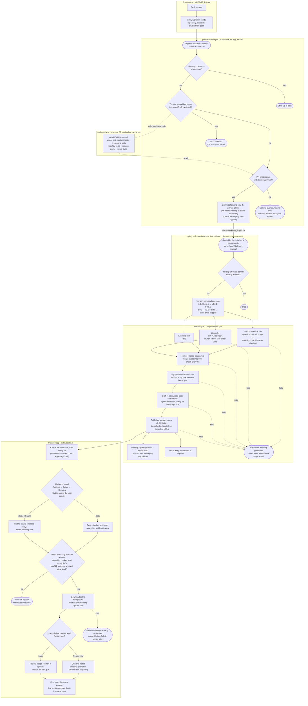

# Update plan: private changes reach users as nightly app builds

Status: on `develop` since #225 (2026-10-15). This revision: the workflow-only pointer bot (no GitHub App), automatic version numbering, and fixes found after the merge.

## Decision

Ship everything, including the closed-source `private/` code, as normal app builds, and make those builds automatic:

```
push to private main
  └─► private-pointer.yml   (workflow: runs the PR checks with the new private/,
        │                    pushes the pointer bump to develop over a deploy key,
        │                    then starts the nightly)
        ▼
every private commit (the daily 02:00 UTC run is commented out for now), or started by hand
  └─► nightly.yml           (builds develop; publishes the version in package.json, e.g. 3.0.2-beta.1)
        └─► release.yml     (build all platforms, check the assets, publish a GitHub pre-release,
                             then commit package.json's next version to develop: 3.0.2-beta.2)
              ▼
beta installs: electron-updater finds it, downloads it in the background, installs on restart
stable installs: unaffected, they only take stable releases
```

This replaces the live engine as the way private changes reach users. The live-engine workflow stays as a manual emergency hotfix path.

## How it works



## How a broken build is caught

Each stage stops everything after it, so a failure anywhere means nothing is published.

| # | Stage | Catches | On failure |
|---|---|---|---|
| 1 | **PR checks** (every PR, including the bot's) | Failing runtime and compiler tests; a private change that breaks the viewer bundle | PR can't merge; the bot leaves it open; Teams alert |
| 2 | **Platform builds** | Any error while building or packing; an empty pack (`build-pack.ts` exits with an error, uploads use `if-no-files-found: error`) | No release |
| 3 | **macOS check**: `codesign --verify --deep --strict`, `spctl --assess`, `stapler validate` | A build electron-builder left unsigned, or one notarization quietly skipped. Either would refuse to install as an update. | No release |
| 4 | **Linux launch smoke test**: the packaged app starts under xvfb with `XGENIA_SMOKE_TEST=1` (`src/main/src/smoke-test.js`) | A build that compiles but crashes, shows a blank window, or hangs on start | No release |
| 5 | **Collecting assets** | A missing platform or chip build, mismatched versions, a manifest listing a file that wasn't built | No release |
| 6 | **Signing** | Missing key, or a key the app doesn't trust | No release |
| 7 | **Verify the draft**: the release is read back from GitHub (`verify-release.mjs --draft`) | A failed or partial upload, a missing manifest or `.sig`, a file of the wrong size | Stays a draft; no install sees it |
| 8 | **Public check** after publishing (`--public`, with retries) | Anything wrong with what installs actually download | Turned back into a draft automatically |
| 9 | **In the app** | A manifest or file that doesn't match what CI signed | Not downloaded |
| — | **Alerts**: `nightly.yml` and `private-pointer.yml` notify Teams on any failure, alongside the existing per-platform build card | — | — |
| — | **Who's affected if something still slips through** | Nightlies only reach users who opted into Beta; Stable releases stay drafts until a person publishes them | — |

The smoke test runs on Linux only: it's the cheapest runner with a virtual display. Windows and macOS share the same app code, so a crash at startup shows up there too. A Windows smoke run (no xvfb needed) is easy to add later if platform-specific crashes appear.

## When a bad build gets out anyway

1. **Stop it spreading:** Actions → **Pull a release** → the tag and a reason. It becomes a draft again, so no install sees it. The equivalent command is `gh release edit <tag> --draft=true`.
2. **Fix the installs that already took it:**
   - A private fix: push it to private `main`, and the bot builds a nightly of it right away.
   - Anything else: revert it on `develop`, then run Actions → **Nightly** → Run workflow.
   - The next nightly always has a higher version. Beta installs update to it within 4 hours, or straight away with Settings → Updates → Check for updates.
3. **A bad Stable release:** pull it the same way, then publish a higher patch version (for example `3.1.1` after `3.1.0`). Never re-use a version number: installs that already have it would never update.

The manual paths still exist alongside it:
- **Stable releases:** run `release.yml` on `main` after `develop` is squash-merged there. It creates a draft, someone checks it and presses Publish, and every install (stable and beta) updates.
- **Emergency engine hotfix:** the `Live Engine` workflow, run by hand. A later app update replaces whatever it shipped.

Why not keep the live engine, or build a separate pro-node pack? Both add code-loading machinery to the app: about 2,600 lines today for the live engine. They exist only because app releases were rare. Fixing the release pipeline fixes the actual problem with tools the app already has.

---

## Why the auto-updater never worked

| # | Problem | Evidence | Fix |
|---|---|---|---|
| 1 | Almost nothing to update to | Only 2 releases ever, `V2.0.0` and `V2.1.0` (last on 2026-06-15). Beta builds were never published. | `nightly.yml` publishes every change to `develop` as a pre-release |
| 2 | Uppercase tags | `V2.1.0` is not valid semver, so electron-updater can't read a channel from it. Beta installs (`3.0.1-beta.9`) saw "2.1.0" as the newest. | `release.yml` already uses lowercase `v` |
| 3 | No macOS update payload | The releases have a `.dmg` but no `-mac-*.zip`. Squirrel.Mac can only install from the zip. | `release.yml` packs the zip (`XGENIA_RELEASE=1`) and merges the per-arch manifests |
| 4 | Releases stopped at a draft | Someone had to press Publish, so builds piled up unpublished. | Nightlies go out published, as pre-releases. Stable releases stay drafts for review. |
| 5 | The update flow itself | It asked before downloading, never asked again after "No", stopped checking once an update was found, and showed error boxes for background failures. | `autoupdater.js` rewritten (below) |
| 6 | Builds ignored the private pointer | `git submodule update --remote` built whatever private `main` was, so a build couldn't be traced to a private commit. | Builds use the pinned pointer, which the bot keeps current |

### The updater flow now (`packages/xgenia-editor/src/main/src/autoupdater.js`)

The same flow VS Code, Slack and Discord use, with no native dialogs:
- First check 30 s after start, then every 4 h.
- **Signed manifests, checked before download.** CI signs every `latest*.yml` with Ed25519 (`scripts/release/sign-update-manifests.mjs`, secret `UPDATE_SIGNING_KEY`). The app fetches the manifest and its `.sig` from the release itself and checks two things: our key signed it, and every file electron-updater is about to download has the signed sha512 (`update-manifest.js`). electron-updater then checks the downloaded file against that sha512. No valid signature means no download.
- Downloads in the background. The title bar shows **"Downloading update 42%"**.
- When it's on disk, an **in-app dialog** (the app's own `ConfirmationDialog`) offers "Restart now" or "Later". After "Later", the title bar keeps a **"Restart to update"** button, and the update installs on quit (`autoInstallOnAppQuit`). State reaches every window over IPC (`auto-update:state`, `auto-update:get-state`, `auto-update:install`).
- A failed background check is logged and retried at the next check. An update that fails **while downloading or installing** is shown in-app: an "Update failed" message from the editor (`BaseWindow.tsx`), and the result in Settings → Updates. This includes macOS failing to stage it (Squirrel.Mac). The app goes back to idle, so the next check retries, instead of sitting at "Downloading 100%".
- **macOS:** "ready" means Squirrel.Mac has staged the update, not just that electron-updater's download finished (#200). Restarting before that would drop the update. Feeds without a build for this Mac's architecture aren't offered (`update-arch.js`).
- **Update channel, chosen in Settings → Editor → Updates, Stable by default.** This is the approach Slack ("Release channel" under Preferences → Advanced) and Obsidian ("Receive early access versions") use. The alternative is a separate side-by-side app (VS Code Insiders, Discord Canary/PTB, Figma Beta), which costs a second app ID and release stream; worth it only once there are many outside beta testers.
  - **Stable:** stable releases only.
  - **Beta (nightly builds):** opt-in. Gets nightlies and betas as well as stable releases. Switching to it checks straight away.
  - **Back to Stable:** never a downgrade, so the app keeps the running build until a newer stable release is out, and a project saved by a nightly is never opened by an older build. A nightly already downloaded is dropped, not installed on quit.
  - The choice is stored by the main process in `<userData>/update-settings.json`, because the updater needs it before any window loads. The section also shows the version, a "Check for updates" button with the result, and "Restart to update" once an update is ready.
  - **Installs from before this code** (`3.0.1`, `3.0.2`) know nothing of the setting. A stable install never takes a nightly. Its first update with this code is the next stable release, and after that its users can opt in to Beta.
- **Linux:** builds ship a `.deb` and an AppImage, both listed in one signed `latest-linux.yml`. The AppImage replaces itself; the `.deb` installs through electron-updater's `DebUpdater` (`pkexec dpkg -i`, so it asks for the admin password once). Other Linux installs don't check.

This is our own version of electron-builder's new built-in feature (Ed25519-signed `latest*.yml`, in `electron-builder@27.0.0-alpha.9`), done without moving to an alpha. When that release is stable, we can switch to it and delete `update-manifest.js`. Its manifest format is different, so that switch needs one release that both formats accept.

---

## What changed

| File | Change |
|---|---|
| `.github/workflows/private-pointer.yml` | **New.** The bot. It's a plain workflow, with no GitHub App or personal token, triggered by the private repo's dispatch, an hourly schedule and manual runs. It reads private `main`, runs `pr-checks.yml` with `private/` at that commit, and only if they pass, pushes a commit that changes nothing but the gitlink, over a deploy key. Pushes over a deploy key start other workflows (pushes with `GITHUB_TOKEN` don't), and a ruleset can let deploy keys bypass `develop`'s PR rule. If the branch moved meanwhile, it re-applies the bump on the newest commit. Throttle: at most one bump per `PRIVATE_POINTER_MIN_HOURS` (default 4). Runs queue rather than cancel. The commit message gives only a count, never private commit messages. |
| `.github/workflows/pr-checks.yml` | **New.** Runs on every PR into `develop`, with the pinned private commit: runtime tests, live-engine tests, release and workflow tests, compiler parity, and a viewer build (which catches a pro-node change that breaks the bundle). The bot also calls it as a reusable workflow, with the private commit it's about to pin. That's the bot's gate. |
| `.github/workflows/nightly.yml` | **New.** Runs after every private pointer bump (the bot starts it) and by hand. A daily 02:00 UTC run is in the file but commented out for now. It always builds `develop`'s newest commit, and does nothing if that commit already has a release. Not on every push to `develop`. It picks the version from `package.json` (see "Version numbering"), calls `release.yml`, and keeps the newest `NIGHTLY_KEEP` (default 10) nightlies, found by their "XGENIA Nightly" title. One build runs at a time, and a burst of pushes collapses into the newest. |
| `.github/workflows/release.yml` | Can be called by another workflow (`version`, `nightly`). A nightly is published as a pre-release. A manual run releases the stable version as a draft. Either way, a `bump-version` job then moves `develop`'s `package.json` on by one, over the deploy key, with `[skip ci]`. |
| `scripts/release/next-version.mjs` | **New.** Version numbering: the nightly version, the stable version, the next version, and a write that never lowers it. Dependency-free; checked against the `semver` package electron-updater uses. |
| `.github/workflows/nightly-builds.yml` | New `version` input, set in the checkout only, and a `ref` input: the commit to build. A scheduled run starts on `main`, so `nightly.yml` passes `develop`'s commit, and the release is tagged on that commit too. Builds the pinned private commit, not `--remote`. |
| `scripts/release/collect-release-assets.mjs` | Releases carry no `.blockmap` files (2026-10-16). Those only enable differential downloads; without them electron-updater downloads the whole installer, so every update is a full download. |
| `.github/workflows/nightly-builds-internal.yml` | Builds the pinned private commit. |
| `.github/workflows/live-engine.yml` | Manual only. No push or dispatch triggers. |
| `packages/xgenia-editor/src/main/src/autoupdater.js` | Rewritten as above: signature check before download, IPC state for the in-app UI, Linux AppImage and `.deb`. |
| `packages/xgenia-editor/src/main/src/update-manifest.js`, `update-public-key.js` | **New.** Parses electron-builder manifests and checks their Ed25519 signature against the files about to download. Pure, so CI and tests use the same code. |
| `scripts/release/sign-update-manifests.mjs`, `update-keygen.mjs` | **New.** CI signing, which also confirms the key in the secret is the one the app trusts, and key generation. |
| `.github/workflows/release.yml` | Signs the manifests before `gh release create`. The key is used only in that job, which installs no npm packages. |
| `scripts/release/collect-release-assets.mjs` | Ships and requires `latest-linux.yml`. |
| `packages/xgenia-editor/package.json` | Linux targets are `deb` and `AppImage`. |
| `packages/xgenia-core-ui/.../TitleBar.tsx`, `packages/xgenia-editor/.../BaseWindow.tsx` | Title bar states for downloading and ready; in-app "Update ready" dialog, opened once per version. |
| `packages/xgenia-editor/src/editor/src/views/panels/EditorSettingsTab/UpdatesSection.tsx`, `hooks/useAutoUpdateState.ts` | **New.** Settings → Editor → Updates: channel (Stable / Beta), version, "Check for updates", "Restart to update". The title bar and this section share one state hook. |
| `src/main/src/smoke-test.js`, `main.js`; `nightly-builds.yml` | **New.** The launch smoke test (Linux, xvfb), the macOS signature and notarization check, and `if-no-files-found: error`. `scripts/build-pack.ts` now fails instead of logging. |
| `scripts/release/verify-release.mjs` | **New.** Reads a release back (draft through `gh`, or public through the download URLs) and checks manifests, signatures and file sizes. |
| `.github/workflows/pull-release.yml` | **New.** Turns a bad release back into a draft and tells Teams. |
| `packages/xgenia-editor/tests/auto-update/smoke-test.test.cjs`, `scripts/release/verify-release.test.mjs` | **New.** Cover pass, blank window, renderer crash, failed load and timeout; and a missing manifest or signature, a foreign key, a missing or truncated file. |
| `packages/xgenia-editor/tests/auto-update/channel.test.cjs` | **New.** Stable by default; Beta allows pre-releases, is saved and checks at once; no downgrades; a nightly downloaded before leaving Beta is not installed; an update failing the signature check is never downloaded. |
| `packages/xgenia-editor/tests/auto-update/update-manifest.test.cjs`, `scripts/release/sign-update-manifests.test.mjs` | **New.** Covers a tampered manifest, a wrong key, a swapped file hash, a stale version, and a signing key the app doesn't trust. |
| `packages/xgenia-editor/tests/updater/update-restart.test.cjs` | #200's tests, rewritten for the in-app flow: macOS waits for Squirrel; Windows is ready after the download; no native dialog; a staging failure is shown to the user; a failed background check is not. Now run by the PR checks too. |
| `packages/xgenia-editor/src/main/src/live-engine/select.js` | Drops downloaded engines when the app version changes. Without this, an engine downloaded earlier would shadow the newer engine inside the nightly. |
| `scripts/release/workflows.test.mjs` | **New.** No inputs pasted into shell scripts; builds use the pinned pointer; the deploy key sits in a job with no `npm install`, which waits for the checks and pushes a pointer-only commit; nightlies publish as pre-releases. |
| `CLAUDE.md`, `docs/agents/git-workflow.md`, `docs/agents/live-engine.md` | Document the two workflow pushes (pointer bump, version bump) as the only things that land on `develop` without a PR, and the new flow. |

### Version numbering

`packages/xgenia-editor/package.json` holds the version the **next** release carries, and every release moves it on by one. Nobody bumps it by hand (`scripts/release/next-version.mjs`):

| `package.json` | Nightly publishes | `package.json` after |
|---|---|---|
| `3.0.2-beta.1` | `v3.0.2-beta.1` | `3.0.2-beta.2` |
| `3.0.2-beta.2` | `v3.0.2-beta.2` | `3.0.2-beta.3` |
| `3.0.3` (stable, not yet released) | `v3.0.3-beta.1`. Never a stable version, which would reach Stable installs. | `3.0.3-beta.2` |
| `3.0.2` (already released) | `v3.0.3-beta.1`. A `3.0.2` beta would sort below `3.0.2`. | `3.0.3-beta.2` |

| `package.json` | Manual `release.yml` (stable) releases | `package.json` after |
|---|---|---|
| `3.0.3-beta.5` | `v3.0.3` (draft, you press Publish) | `3.0.4` |
| `3.0.3` | `v3.0.3` | `3.0.4` |

**The rules:**
- **Bumping:** a stable version moves to the next patch. A pre-release has its last number increased.
- **Taken versions:** a version that already has a release, drafts included, is skipped forward. This covers two runs racing.
- **Never lowered:** if someone sets `package.json` higher by hand (for example `3.1.0-beta.1` for a minor release), the bump leaves it alone, and the next nightly carries it.
- **No loop:** the bump commit carries `[skip ci]`, so it doesn't start another nightly.
- **Ordering:** checked against the `semver` package electron-updater uses. Each nightly sorts above the last, and a stable release outranks its betas.
- **Channel:** a nightly's label (`beta`) is what the Beta channel follows.

### How it handles uneven private activity

| Day | What happens |
|---|---|
| One private commit | The dispatch arrives, the bot runs the checks, pushes the bump and starts the nightly. Users on Beta have it in about 1–1.5 h. |
| Twenty private commits | Every one is bumped, but bot runs and nightlies each queue only the newest run behind the one in progress. A burst therefore becomes a handful of builds of the latest commit, not twenty. If that's still too many, set `PRIVATE_POINTER_MIN_HOURS` (for example `4`) to hold bumps back. |
| Changes merged into `develop` by people | No nightly per merge. The next private commit's nightly includes them, or start one by hand (Actions → Nightly → Run workflow). The daily run that used to catch these is paused. |
| Nothing changed | A manual run finds `develop`'s newest commit already released and stops. The paused daily run would do the same. |
| A dispatch is lost | The hourly bot run notices the pointer is behind. |
| A check fails | Nothing is pushed and no nightly starts. The run fails and Teams is told. The next private push, or the hourly run, tries again. |

---

## Setup checklist (once; a repo admin can do all of it, no org settings)

1. **Deploy key** (one key for both workflow pushes: the pointer bump and the version bump). Generate a key pair with no passphrase:
   ```bash
   ssh-keygen -t ed25519 -N "" -C "xgenia release bot" -f xgenia-bot
   ```
2. **Add both halves:**
   - Settings → Deploy keys → Add: paste `xgenia-bot.pub`, tick **Allow write access**.
   - Settings → Secrets and variables → Actions → New secret **`BOT_DEPLOY_KEY`**: paste the whole of `xgenia-bot`, the private half. Upload it with `gh secret set BOT_DEPLOY_KEY < xgenia-bot`, so the line breaks survive.
   - Delete both files afterwards.
   - The org can switch deploy keys off for all repos. If the Deploy keys page says so, ask an org owner.
   - **Until this secret exists:** the pointer bot skips quietly (a notice in the run, no alert), and after each nightly the version bump fails and alerts Teams. So set it before the first nightly.
3. **Ruleset on `develop`** (Settings → Rules → Rulesets):
   - Require a pull request with approval, and **`PR checks / Engine tests`** as a required status check.
   - Bypass list: **Deploy keys**.
   - If `develop` is protected by a classic branch protection rule, move that protection into this ruleset. Classic rules can't let deploy keys bypass, and both would apply. Without the bypass, both workflow pushes are rejected.
4. **Update signing key:** add the repo secret **`UPDATE_SIGNING_KEY`**, the private half of the key whose public half is in `update-public-key.js`. Then delete the local `.pem`. Without the secret, `release.yml` stops before publishing: a release with no signatures would install nowhere. To rotate the key, run `node scripts/release/update-keygen.mjs <out.pem>`, set the new secret, and ship one release signed with the old key that carries the new public key.
5. **Optional repo variables:** `PRIVATE_POINTER_MIN_HOURS` (default 4) and `NIGHTLY_KEEP` (default 10).
6. **Release to `main` once.** GitHub runs `repository_dispatch`, `schedule` and manually started workflows only from the default branch's copy, so the pointer bot and "Pull a release" start after the next `develop` → `main` release. `nightly.yml` and the version bump already run from `develop`.
7. **Private repo:** `notify-live-engine.yml` only fires for `xgenia-pro-nodes/**` and `xgenia-agent-nodes/**`. The editor also bundles `xgenia-ai` and `xgenia-image-editor`, so drop the `paths:` filter and rename the file `notify-xgenia.yml`. The event name `private-main-push` stays. Until then, the hourly schedule catches the other changes.
8. **Versions:** nothing to do. `package.json` is at `3.0.2-beta.1`, so the next nightly publishes `v3.0.2-beta.1`, and `develop` moves to `3.0.2-beta.2` (see "Version numbering"). To start a minor release, set it by hand once (for example `3.1.0-beta.1`). It counts on from there.

---

## Next, recommended

| Item | Why | Notes |
|---|---|---|
| **Sign the Windows build** | Unsigned NSIS installers get SmartScreen "Unknown publisher" warnings, and updates can be blocked. | Azure Trusted Signing costs about $10/month and is supported natively by electron-builder ≥ 25 through `win.azureSignOptions`. We're on 24.13.3, so this needs an upgrade. |
| ~~Signed update manifests~~ | **Done on this branch** (our own Ed25519 check, see above). | Switch to electron-builder's built-in version once `electron-builder@27` is stable. |
| ~~In-app update UI~~ | **Done on this branch**: title bar states plus an in-app dialog; native dialogs removed. | |
| ~~Linux~~ | **Done on this branch**: AppImage plus `.deb`, both updating. | An apt repository would let `.deb` users update without the password prompt. |
| **Staged rollout for stable releases** | Catch a bad release at 10% of users before 100%. | `stagingPercentage` in `latest*.yml`. It would have to be added before signing, since the signature covers the manifest. To pull a release, ship a higher version. |
| **Remove the live engine** | About 2,600 lines that only matter for hotfixes now. | After a few weeks of nightlies with no hotfix needed. |

---

## Sources

- Electron, updating applications: https://www.electronjs.org/docs/latest/tutorial/updates
- Electron `autoUpdater` (Squirrel; background download, applied on restart): https://www.electronjs.org/docs/latest/api/auto-updater
- electron-builder auto update (macOS needs the zip target and code signing): https://www.electron.build/docs/features/auto-update/
- electron-builder signed update manifests: https://www.electron.build/docs/features/signed-update-manifests/
- electron-builder Windows code signing: https://www.electron.build/docs/features/code-signing/code-signing-win/
- Electron code signing: https://www.electronjs.org/docs/latest/tutorial/code-signing
- Auto-updates with electron-updater (background download, staged rollouts): https://www.emadibrahim.com/electron-guide/auto-updates
- Lessons from 25 releases of Electron auto-update: https://dev.to/ryuji_saas/lessons-from-building-electron-auto-update-across-25-releases-1ah7
- How to notarize and publish an Electron app on macOS (2026): https://www.forasoft.com/blog/article/the-pain-of-publishing-electron-apps-on-macos-303
- LobeHub's Electron OTA design (the live-engine alternative): https://innei.in/en/posts/tech/electron-ota-updater
- Grafana plugin signing (the node-pack alternative): https://grafana.com/docs/grafana/latest/administration/plugin-management/plugin-sign/
- VS Code vs Code - OSS: https://github.com/microsoft/vscode/wiki/Differences-between-the-repository-and-Visual-Studio-Code
- Expo EAS Update, runtime version and signed updates: https://www.shipnative.dev/blog/expo-ota-updates
